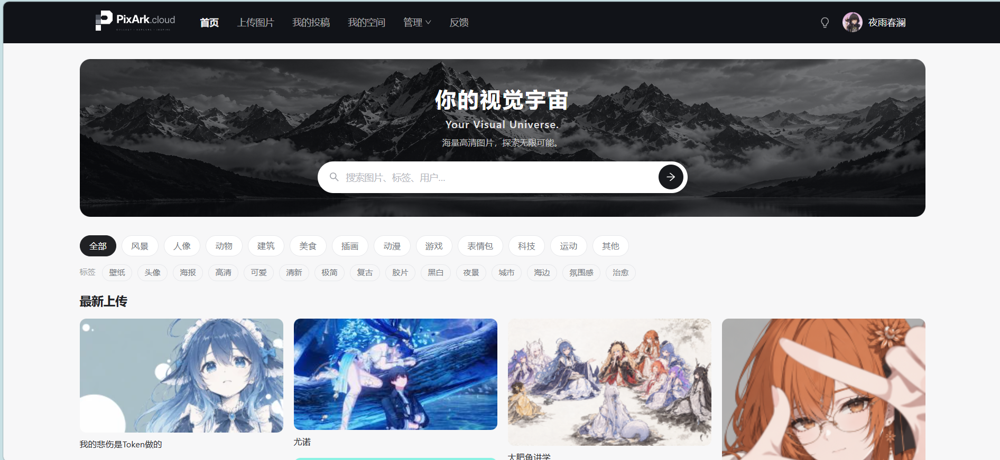

# PixArk Frontend



PixArk 云图库的前端，基于 Vue 3 + Vite 6 + TypeScript + Ant Design Vue 4。

## 功能

- 公共图库浏览、搜索、分类筛选和详情查看
- 图片上传：本地文件上传、URL 抓取、拖拽上传
- 私有空间：创建空间、空间配额、空间图片管理
- 图片审核：待审核、通过、拒绝
- AI 图片编辑：扩图、去水印、高清放大、上色、风格化、局部重绘
- 以图搜图：提交异步任务并轮询结果
- 图库分析：分类、标签、大小、用量等图表
- 用户中心、头像上传、管理员后台
- 深色 / 浅色主题与移动端适配

## 技术栈

| 分类 | 技术 |
| --- | --- |
| 框架 | Vue 3.5、TypeScript、Vite 6 |
| UI | Ant Design Vue 4、Ant Design Icons Vue |
| 状态管理 | Pinia |
| 路由 | Vue Router 4 |
| 图表 | ECharts 5、vue-echarts、echarts-wordcloud |
| 请求 | Axios |
| 图片处理 | cropperjs、file-saver |
| 日期 | dayjs |

## 项目结构

```text
src/
├── api/            # 后端接口封装与类型定义
├── assets/         # 静态资源
├── components/     # 通用组件与业务组件
├── composables/    # 组合式函数
├── pages/          # 页面（首页、详情、空间、管理后台等）
├── router/         # 路由配置
├── stores/         # Pinia 状态
├── utils/          # 工具函数
├── request.ts      # Axios 实例
└── main.ts         # 入口
```

## 本地运行

### 1. 环境要求

- Node.js 18+（建议 20 LTS 或 22 LTS）
- npm 9+
- 后端服务已启动在 `http://localhost:8123`

### 2. 安装依赖

```bash
npm install
```

### 3. 启动开发服务器

```bash
npm run dev
```

打开 `http://localhost:5173`。

Vite 已配置代理：`/api` 会转发到 `http://localhost:8123`，所以本地开发不需要处理跨域。配置见 `vite.config.ts`。

### 4. 构建生产产物

```bash
npm run build
```

构建命令会先执行 `vue-tsc --build` 做类型检查，再执行 `vite build`。产物在 `dist/`，可以直接交给 Nginx 托管。

### 5. 本地预览构建产物

```bash
npm run preview
```

## 配置说明

前端不需要 `.env` 文件。`src/request.ts` 里的 baseURL 是相对路径 `/api`：

- 开发环境：Vite 把 `/api` 代理到 `localhost:8123`
- 生产环境：Nginx 把 `/api` 反向代理到后端 `127.0.0.1:8123`

这样浏览器始终访问同源地址，不需要额外配置 CORS，登录 Cookie 也能正常携带。**不要把服务器 IP 或域名写死在前端代码里**，否则换域名、上 HTTPS 都要重新构建。

图片地址来自腾讯云 COS，需要在 COS 控制台配置：

- 桶的读权限（浏览器能访问图片）
- 防盗链（允许站点来源，并允许空 Referer，后端和 AI 拉图需要）
- CORS（前端下载图片时需要）

## 截图


## 部署

1. 执行 `npm run build`
2. 把 `dist/` 里的内容上传到 Nginx 站点目录（例如 `/www/wwwroot/pixark`）
3. Nginx 配置参考后端仓库的 `pixark-backend/deploy/nginx/pixark.conf`
4. 刷新页面时由 `try_files $uri $uri/ /index.html` 回落到入口文件

## 已知限制

- 必须连接后端服务，项目没有内置 Mock 数据。
- 图片直接来自 COS，COS 的读权限、防盗链或 CORS 配置错误会导致裂图或下载失败。
- 以图搜图和 AI 图片编辑都是异步任务，需要后端开启 RabbitMQ 和对应第三方服务。
- 项目目前没有前端自动化测试。

## License

本项目基于 MIT License 开源，详见 [LICENSE](LICENSE)。

> MIT 仅覆盖代码；`public/brand` 与 `docs/screenshots` 中的品牌素材和截图涉及第三方图片版权，不随 MIT 授权。
